# Sistema de Chamados — API REST com Spring Boot, JPA e PostgreSQL

API REST para gerenciar chamados de suporte. Evolução do Trabalho 01: os dados agora ficam **salvos no PostgreSQL** e a API tem operações completas de CRUD, com DTOs.

## Estrutura do projeto

```
catalogo/
├── docker-compose.yml                  (sobe o PostgreSQL)
├── pom.xml
├── README.md
└── src/main/
    ├── resources/application.properties  (conexão com o banco)
    └── java/br/ufba/matc76/catalogo/
        ├── CatalogoApplication.java
        ├── config/
        │   └── DadosIniciais.java        (cadastra 12 chamados na primeira execução)
        ├── controller/
        │   └── ChamadoController.java    (endpoints REST)
        ├── dto/
        │   ├── ChamadoEntradaDTO.java    (dados recebidos no POST e no PUT)
        │   └── ChamadoSaidaDTO.java      (dados retornados pela API)
        ├── model/
        │   ├── Chamado.java              (entidade JPA)
        │   ├── Prioridade.java           (BAIXA, MEDIA, ALTA)
        │   └── Status.java               (ABERTO, EM_ANDAMENTO, RESOLVIDO)
        └── repository/
            └── ChamadoRepository.java    (acesso ao banco com Spring Data JPA)
```

## Como configurar e executar

Pré-requisitos: Java 25, Docker (com Docker Compose). Ambos já estão disponíveis no GitHub Codespaces.

**1. Subir o banco de dados** (na pasta do projeto):

```bash
docker compose up -d
```

O PostgreSQL fica disponível na porta **5433** da máquina, com banco, usuário e senha `mata76`. Para conferir se está pronto:

```bash
docker compose ps
```

**2. Executar a aplicação:**

```bash
./mvnw spring-boot:run
```

A API sobe em `http://localhost:8080`. Na primeira execução, a tabela `chamados` é criada automaticamente e recebe 12 chamados fictícios.

**3. Encerrar:**

- Aplicação: `Ctrl+C` no terminal onde ela está rodando.
- Banco: `docker compose down` (os dados são mantidos no volume `catalogo-pgdata`).
- Banco e dados: `docker compose down -v` (apaga também os chamados).

### Configuração da conexão (`application.properties`)

```properties
spring.datasource.url=jdbc:postgresql://localhost:5433/mata76
spring.datasource.username=mata76
spring.datasource.password=mata76
spring.jpa.hibernate.ddl-auto=update
```

Esses valores precisam ser iguais aos definidos no `docker-compose.yml`.

## Endpoints

| Método | Rota | Descrição | Status |
|---|---|---|---|
| GET | `/chamados` | Lista todos os chamados | 200 |
| GET | `/chamados/{id}` | Consulta por ID | 200 / 404 |
| GET | `/chamados/setor?nome=financeiro` | Filtra por setor | 200 |
| GET | `/chamados/prioridade?nivel=alta` | Filtra por prioridade | 200 |
| GET | `/chamados/busca?texto=impressora` | Busca no título | 200 |
| GET | `/chamados/criticos` | Prioridade ALTA e não resolvidos | 200 |
| GET | `/chamados/resumo` | Quantidade por status e total | 200 |
| POST | `/chamados` | Cadastra um chamado | 201 / 400 |
| PUT | `/chamados/{id}` | Atualiza um chamado | 200 / 400 / 404 |
| DELETE | `/chamados/{id}` | Exclui um chamado | 204 / 404 |

Regras:
- Setor, prioridade e busca por título **não diferenciam maiúsculas de minúsculas**.
- No POST e no PUT, `titulo`, `solicitante`, `setor` e `prioridade` são obrigatórios (senão, 400). O `status` é opcional: no POST o padrão é `ABERTO`; no PUT, se não for enviado, o status atual é mantido.
- O `id` é gerado pelo banco e nunca é recebido no corpo da requisição.

## Testes e demonstração

> Os resultados valem para o banco recém-criado, com os 12 chamados iniciais, executando os testes na ordem abaixo. 

### 1. Listar todos
```bash
curl -i http://localhost:8080/chamados
```
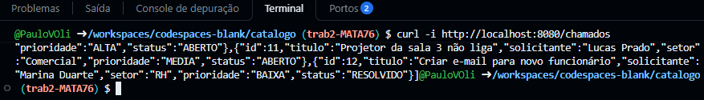

**Código:** `200 OK` — array JSON com 12 chamados (ids 1 a 12).
**Explicação:** o Repository lê todos os registros da tabela `chamados`.

### 2. Consultar por ID
```bash
curl -i http://localhost:8080/chamados/3
```
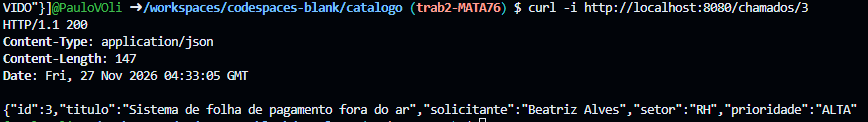

**Código:** `200 OK`
```json
{"id":3,"titulo":"Sistema de folha de pagamento fora do ar","solicitante":"Beatriz Alves","setor":"RH","prioridade":"ALTA","status":"EM_ANDAMENTO"}
```
**Explicação:** retorna o chamado de id 3.

### 3. Consultar ID inexistente
```bash
curl -i http://localhost:8080/chamados/99
```
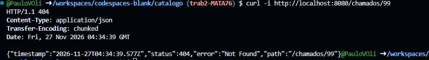

**Código:** `404 Not Found`
**Explicação:** o banco não tem chamado com id 99.

### 4. Filtrar por setor
```bash
curl -i "http://localhost:8080/chamados/setor?nome=FINANCEIRO"
```
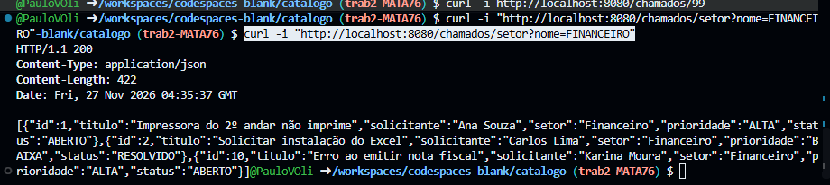

**Código:** `200 OK` — chamados de ids **1, 2 e 10**.
**Explicação:** o filtro ignora maiúsculas/minúsculas.

### 5. Filtrar por prioridade
```bash
curl -i "http://localhost:8080/chamados/prioridade?nivel=alta"
```
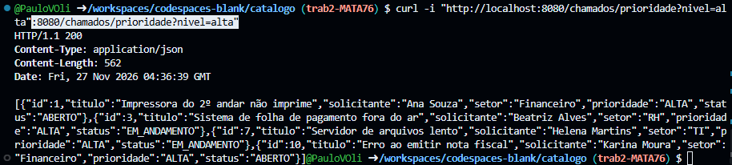

**Código:** `200 OK` — chamados de ids **1, 3, 7 e 10**.
**Explicação:** todos têm prioridade ALTA, em qualquer status.

### 6. Buscar pelo título
```bash
curl -i "http://localhost:8080/chamados/busca?texto=IMPRESSORA"
```
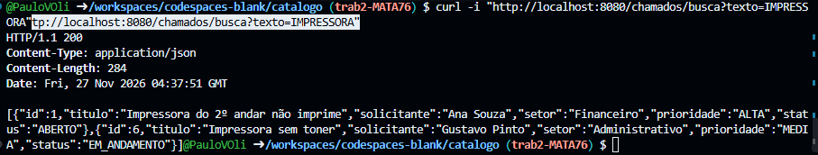

**Código:** `200 OK` — chamados de ids **1 e 6**.
**Explicação:** a busca procura o texto em qualquer parte do título, sem diferenciar maiúsculas/minúsculas.

### 7. Chamados críticos
```bash
curl -i http://localhost:8080/chamados/criticos
```
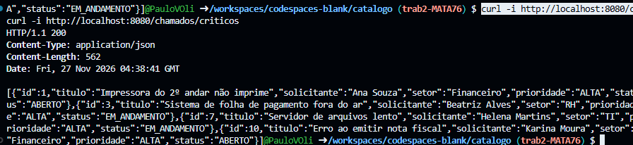

**Código:** `200 OK` — chamados de ids **1, 3, 7 e 10**.
**Explicação:** combina prioridade ALTA com status diferente de RESOLVIDO.

### 8. Resumo por status
```bash
curl -i http://localhost:8080/chamados/resumo
```
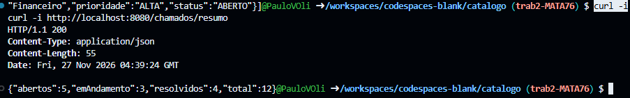

**Código:** `200 OK`
```json
{"abertos":5,"emAndamento":3,"resolvidos":4,"total":12}
```
**Explicação:** conta os chamados de cada status no banco.

### 9. Cadastrar novo chamado
```bash
curl -i -X POST http://localhost:8080/chamados \
  -H "Content-Type: application/json" \
  -d '{"titulo":"Notebook não liga","solicitante":"Paulo Reis","setor":"TI","prioridade":"ALTA"}'
```
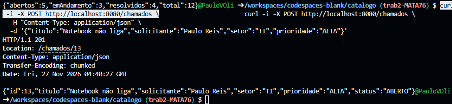

**Código:** `201 Created`, header `Location: /chamados/13`
```json
{"id":13,"titulo":"Notebook não liga","solicitante":"Paulo Reis","setor":"TI","prioridade":"ALTA","status":"ABERTO"}
```
**Explicação:** o banco gerou o id 13 e o status ficou `ABERTO` por padrão.

### 10. Atualizar um chamado
```bash
curl -i -X PUT http://localhost:8080/chamados/13 \
  -H "Content-Type: application/json" \
  -d '{"titulo":"Notebook não liga - troca de bateria","solicitante":"Paulo Reis","setor":"TI","prioridade":"ALTA","status":"EM_ANDAMENTO"}'
```
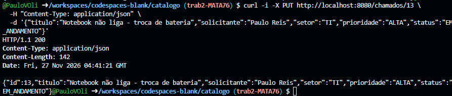

**Código:** `200 OK`
```json
{"id":13,"titulo":"Notebook não liga - troca de bateria","solicitante":"Paulo Reis","setor":"TI","prioridade":"ALTA","status":"EM_ANDAMENTO"}
```
**Explicação:** o chamado 13 foi modificado (mesmo id); nenhum registro novo foi criado.

### 11. Atualizar ID inexistente
```bash
curl -i -X PUT http://localhost:8080/chamados/99 \
  -H "Content-Type: application/json" \
  -d '{"titulo":"X","solicitante":"Y","setor":"TI","prioridade":"BAIXA"}'
```
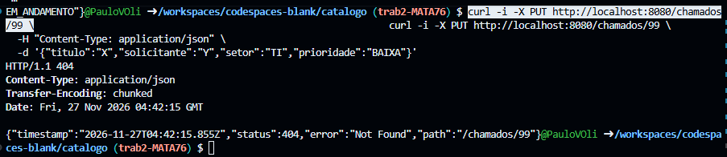

**Código:** `404 Not Found`
**Explicação:** não há chamado 99 para atualizar.

### 12. Excluir um chamado
```bash
curl -i -X DELETE http://localhost:8080/chamados/2
```
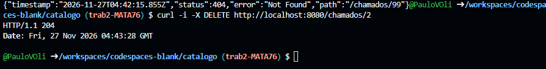

**Código:** `204 No Content` (sem corpo).
**Explicação:** o chamado 2 foi removido do banco.

### 13. Verificar a exclusão
```bash
curl -i http://localhost:8080/chamados/2
curl -i http://localhost:8080/chamados/resumo
```
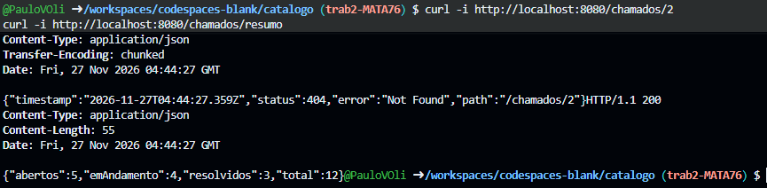

**Código:** `404 Not Found` para o chamado 2; o resumo retorna `200 OK`:
```json
{"abertos":5,"emAndamento":4,"resolvidos":3,"total":12}
```
**Explicação:** o chamado 2 não existe mais. O total é 12: 12 iniciais + 1 cadastrado − 1 excluído.

### 14. Excluir ID inexistente
```bash
curl -i -X DELETE http://localhost:8080/chamados/99
```
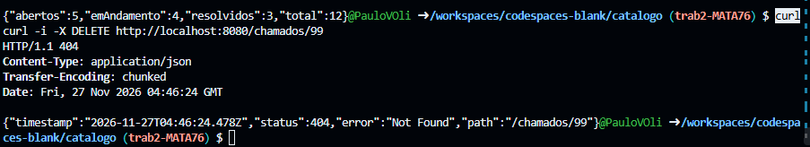

**Código:** `404 Not Found`
**Explicação:** não há chamado 99 para excluir.

### 15. Persistência após reiniciar a aplicação
1. No terminal da aplicação, pare com `Ctrl+C`.
2. Execute novamente: `./mvnw spring-boot:run` (o banco continua rodando no Docker).
3. Consulte:
```bash
curl -i http://localhost:8080/chamados/13
curl -i http://localhost:8080/chamados/2
curl -i http://localhost:8080/chamados/resumo
```
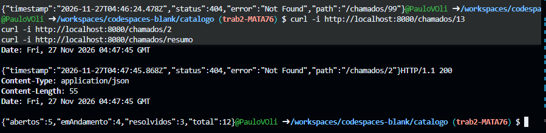

**Código:** `200 OK` para o chamado 13, já com o título atualizado e status `EM_ANDAMENTO`; `404` para o chamado 2; resumo igual ao do teste 13 (`total: 12`).
**Explicação:** os dados estão no PostgreSQL, não na memória da aplicação. Além disso, os dados iniciais não são cadastrados de novo porque a tabela não está vazia.

## Análise técnica

### Alterações em relação ao Trabalho 01
- **Armazenamento:** a lista em memória (`CopyOnWriteArrayList`) foi substituída pelo PostgreSQL.
- **Model:** `Chamado` deixou de ser um `record` e virou uma entidade JPA (`@Entity`). `Prioridade` e `Status` continuam iguais.
- **Repository:** novo `ChamadoRepository`, que faz todas as consultas ao banco.
- **DTOs:** novos `ChamadoEntradaDTO` (entrada) e `ChamadoSaidaDTO` (saída). O controller não expõe mais a entidade.
- **Novos endpoints:** `PUT /chamados/{id}` e `DELETE /chamados/{id}`.
- **Dados iniciais:** a carga dos 12 chamados saiu do construtor do controller e foi para `DadosIniciais`, que só insere se a tabela estiver vazia.
- **Infraestrutura:** `docker-compose.yml` para o banco, dependências `data-jpa` e `postgresql` no `pom.xml` e configuração da conexão no `application.properties`.
- **Mantido:** os 8 endpoints, as URLs, o formato do JSON e as regras (busca sem diferenciar maiúsculas de minúsculas, críticos, resumo, 201 no cadastro).

### Como o Spring Data JPA e o Repository substituíram a memória
`ChamadoRepository` é uma interface que estende `JpaRepository<Chamado, Long>`. Só de estendê-la, já temos `findAll`, `findById`, `save`, `delete` e `count`, sem escrever SQL. Para os filtros, o Spring Data cria a consulta a partir do **nome do método**. Por exemplo, `findByTituloContainingIgnoreCaseOrderByIdAsc` vira uma busca por título que contém o texto, sem diferenciar maiúsculas de minúsculas, ordenada por id. O controller recebe o repository pelo construtor e o usa no lugar da lista Java.

### Como funciona a persistência no PostgreSQL
A classe `Chamado` é mapeada para a tabela `chamados` (`@Entity` e `@Table`). O id é gerado pelo banco (`@GeneratedValue(IDENTITY)`) e `prioridade` e `status` são salvos como texto (`@Enumerated(STRING)`). Com `ddl-auto=update`, o Hibernate cria a tabela se ela não existir. Quando o controller chama `repository.save(...)`, o Hibernate gera o `INSERT` ou o `UPDATE` e envia ao PostgreSQL pela conexão configurada. Como os dados ficam no banco, que roda em um container Docker com volume, eles continuam lá quando a aplicação reinicia.

### Diferença entre entidade JPA e DTO
- **Entidade (`Chamado`):** representa a tabela do banco. É gerenciada pelo JPA e contém o que é necessário à persistência.
- **DTO (`ChamadoEntradaDTO` e `ChamadoSaidaDTO`):** define o formato do JSON que entra e sai da API. Não tem relação com o banco.

Separá-los evita expor a estrutura interna do banco, impede que o cliente defina campos que não deve controlar (como o `id`) e permite mudar a tabela sem quebrar o contrato da API. A conversão entidade → DTO é feita por `ChamadoSaidaDTO.de(...)`.

### Como funcionam a atualização e a exclusão
- **PUT:** o controller busca o chamado pelo id (`findById`). Se não existir, responde 404. Se existir, valida o corpo, altera os campos da própria entidade e chama `save`. Como a entidade já tem id, o JPA faz um `UPDATE` no mesmo registro, sem criar outro. Responde 200 com o chamado atualizado.
- **DELETE:** o controller busca o chamado (404 se não existir), chama `repository.delete(...)`, que executa o `DELETE` no banco, e responde 204 sem corpo.

### Como configurar e executar
Veja a seção "Como configurar e executar" no início deste README: `docker compose up -d` para o banco e `./mvnw spring-boot:run` para a aplicação.
